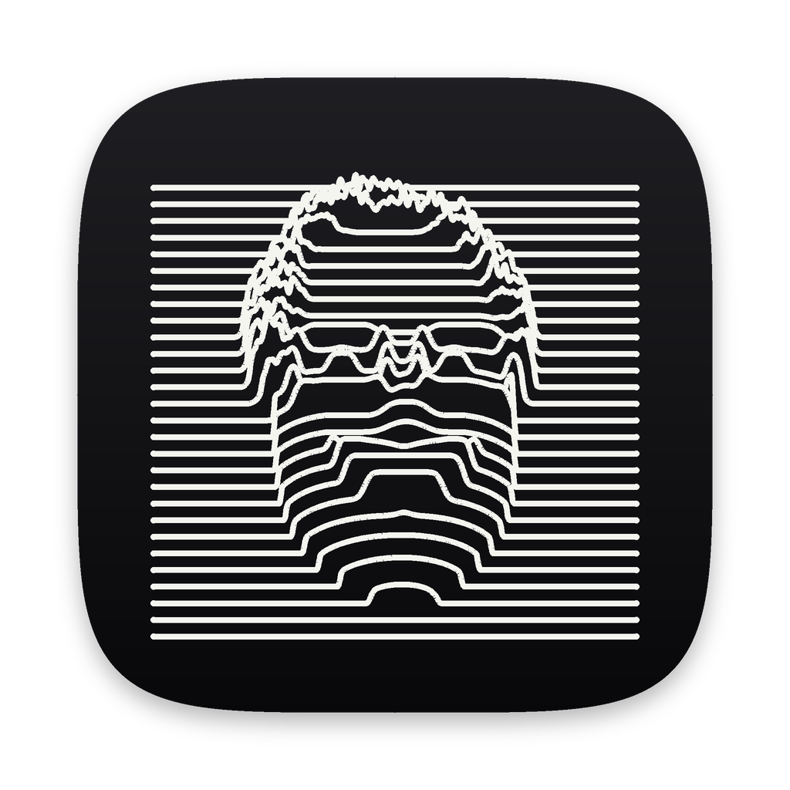

# jim-viz

Reactive, generative low-poly 3D visuals for DJ sets, native on macOS (Swift + Metal). Build a chain of inputs, modulators, a generator and effects, map signals like the kick or an LFO onto any knob, and send it fullscreen to a projector.
